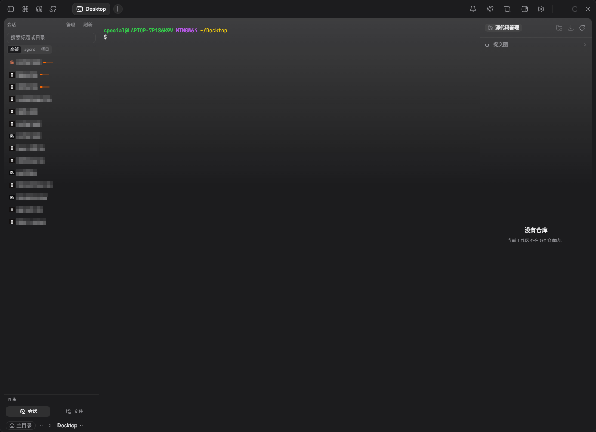
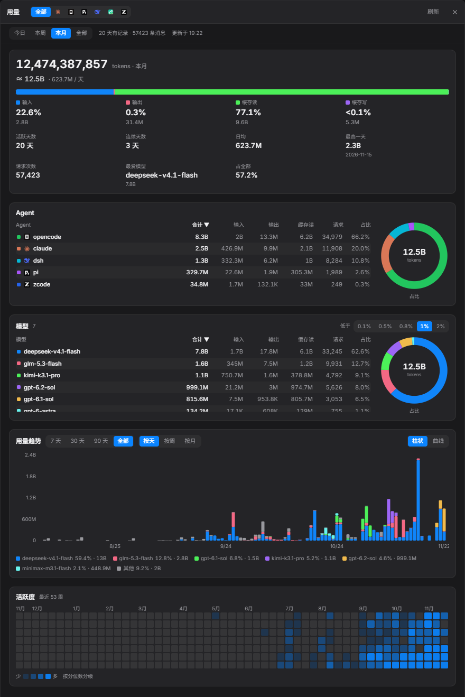

<div align="center">
  
  <h1>Verta</h1>

  <p><strong>A Windows-first desktop workbench: sessions, terminal, editor and Git in one window.</strong></p>

  <p>
    <a href="./README.zh-CN.md">简体中文</a> | <strong>English</strong>
  </p>

  <p>
    
    
    <a href="https://github.com/Zomcxj/Verta/actions/workflows/ci.yml"></a>
  </p>
</div>

---

Verta is a terminal-first desktop workbench built around the coding agents already installed on your machine. It does not implement an agent of its own: it lists the real sessions your agents have on this machine, reopens one in its own project directory with a click, and keeps the terminal, the editor and Git in the same window. Built on Tauri 2 + Rust and React 19, with ghostty as the rendering core (WebGPU, self-drawn). The interface is bilingual, Chinese and English, following the system by default.

|  |  |
|---|---|

## Features

### Sessions

- Lists the real sessions of the agents on this machine, reading their own data.
- Opening a session reopens it in its own project directory; a transition covers the moment the resume command lands in the terminal.
- Subagent sessions are hidden unless the manage view is on.
- Multi-select delete: the backend re-checks before and after, a session that cannot be deleted says why, and a failure is never disguised as success.
- The list follows the session files as they change, with no Refresh to press.

### Windows and WSL together

- WSL-side data is queried inside the distribution, so it is not subject to WAL locks on the `/mnt` mount.
- The WSL switch is off by default: while off it only stops Verta's own queries and leaves WSL alone; once on, it can run `wsl --shutdown` on close, which interrupts everything running inside WSL.
- When a distribution has no data of its own, the interface says so instead of drawing an empty list.
- The environment is inferred from the path, so the terminal, the file tree and the status queries always land on the same side.

### Terminal

- ghostty is the rendering core (WebGPU, self-drawn), with multiple tabs and split panes.
- A picture in a session is drawn by the agent itself inside the terminal, as a block mosaic: it scrolls and disappears with the text, and Verta draws no second layer over it.
- Files dragged in from a browser or the desktop become safely quoted paths for the shell.
- The session list and the terminal live side by side.

### Editor and preview

- CodeMirror 6, with the common languages.
- Images open in a preview: dimensions, zoom, a transparent checkerboard.
- Local images in Markdown resolve relative to the document's own directory, under the workspace allow-list.
- A live preview sits to the right of the editor.

### Git

- The Git panel is on the right of the window and can be read beside the project list; its collapse button mirrors the one at the top left.
- The projects tab shows project, branch, status, uncommitted count, upstream and stash count, with filtering and sorting.
- The remotes tab lists the repositories the account can reach, through the locally signed-in `gh`.
- Each repository's Releases are read inside the app (version list, body, assets); an asset download reports real byte progress and lands in the directory you chose, and a failed or cancelled download leaves no half file and never touches an existing one.

### Usage

- A window of its own, totalling what the six agents on this machine wrote to disk themselves: the total, input / output / cache read / cache write, and request counts.
- A background tick reads the stores once a minute, so an opened window borrows the last result instead of waiting for another scan.
- One table for agents and one for models, each sortable by any column; the model table can fold rows below a share into one line and still add up to the total.
- Trend chart over 7 / 30 / 90 / 180 days and everything; a day is at least 7px wide, the plot scrolls sideways when it does not fit, the wheel scrolls it too, and the y axis stays outside the scroller.
- An activity heatmap shows how dense the last year of use was, and midnight moves it to the new day on its own.
- Read-only: no session file is changed and nothing is uploaded.

### Interface

- Two languages, Chinese and English, following the system by default; only interface text is translated.
- Seven shapes (Minimal, Cloud, Emboss, Slab, Carbon fiber, Acrylic, Glass). Acrylic and Glass expose pane opacity, edge light and sheen, each resettable to its default.

## Requirements

- Windows 10 / 11 (x64), using the system WebView2. **This release is Windows only**: the installer
  is the single artifact 1.0.0 produces, and the macOS and Linux packaging is not part of it.
- Node.js 22 or newer, pnpm 11
- A stable Rust toolchain (builds the Tauri backend)

## What 1.0.0 does not do

- **No auto-update.** The updater is wired but has no repository or signing key, so it reports
  "nothing to do" rather than offering a new version. A release is installed by hand.
- **The installer is not code-signed**, so Windows SmartScreen shows an "unknown publisher" prompt
  the first time it runs. The binary is the one published here; there is no other distribution.
- **Nothing is uploaded.** There is no telemetry, no account and no remote service of this project.

## Development

```bash
pnpm install
pnpm tauri dev      # run in development
pnpm tauri build    # package
```

## Gates

```bash
pnpm check-types
pnpm lint
pnpm test                                   # add --maxWorkers=2 when memory is short

cd src-tauri
cargo clippy --all-targets -- -D warnings   # add -j 2 when memory is short
cargo test --lib
```

## Stack

Tauri 2, Rust, `portable-pty`, React 19, TypeScript, Vite, ghostty (WebGPU), CodeMirror 6, Tailwind v4, shadcn/ui, Zustand.

## Documentation

The documentation is written in English, one file per subsystem.

- [`docs/`](docs/README.md) - the map of all of it
- [`VERTA.md`](VERTA.md) - the project, the quality bar, the conventions, the architecture map
- [`architecture.md`](docs/architecture.md) - the two-process model, the command surface, the module layout, the known gotchas
- [`terminal-rendering.md`](docs/terminal-rendering.md) - terminal rendering, resources and budgets
- [`session-list.md`](docs/session-list.md) - the session list, the hover card and info dialog, subagents, delete
- [`usage.md`](docs/usage.md) - the usage window: the six readers, model identity, folding, the trend chart
- [`testing.md`](docs/testing.md) - the gates, the layers of testing, the probes, the known flakes
- [`CHANGES.md`](CHANGES.md) - every difference from upstream
- [`CONTRIBUTING.md`](CONTRIBUTING.md) / [`SECURITY.md`](SECURITY.md)

## License

Apache-2.0, see [`LICENSE`](LICENSE). The copyright line keeps both this project and the upstream one; see the top of the file.

## Acknowledgements

This project is a derivative of [Terax AI](https://github.com/crynta/terax-ai) (Apache-2.0). Every difference from upstream is recorded in `CHANGES.md`.
